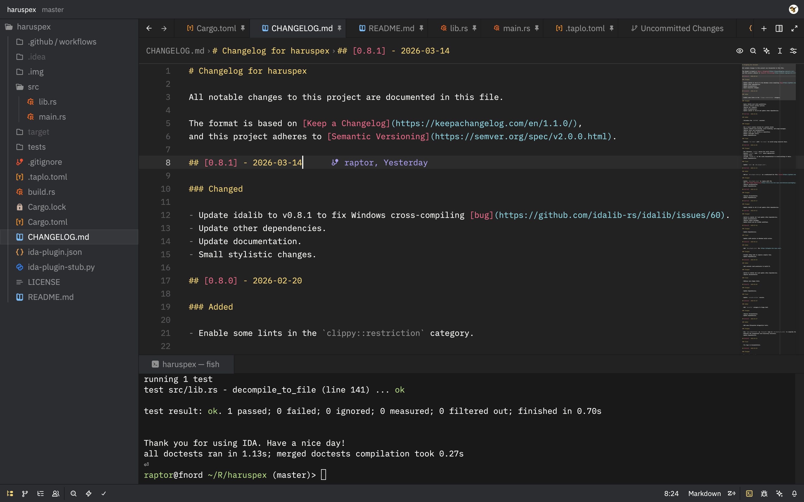

# dotfiles

[](https://github.com/0xdea/dotfiles)
[](https://github.com/0xdea/dotfiles)
[](https://github.com/0xdea/dotfiles)
[](https://www.gnu.org/software/stow/)
[](https://infosec.exchange/@raptor)

> "When I am working on a problem I never think about beauty, but when I have finished, if the solution is not
> beautiful, I know it is wrong."
>
> -- R. Buckminster Fuller

My dotfiles for Linux and macOS.



My dotfiles are currently managed with [GNU Stow]. Each top-level directory represents a configuration package:

- [**base16**](base16). Personalized color schemes based on [Tinted Theming].
- [**cargo**](cargo). Configuration files for the [Cargo] Rust package manager.
- [**claude**](claude). Configuration files for [Claude code].
- [**claude-mac**](claude-mac). [Claude code] settings for macOS, not stowed by my dev containers.
- [**container**](container). Configuration files for [Apple container] machines.
- [**fish**](fish). Configuration files for the [fish] shell.
- [**fonts**](fonts). The free and open source [JetBrains Mono] fonts.
- [**git**](git). Configuration files for the Git version control system.
- [**iterm2**](iterm2). Configuration files for the [iTerm2] macOS terminal emulator.
- [**nvim**](nvim). Configuration files for the [Neovim] editor.
- [**pics**](pics). Some pictures for backgrounds and avatars.
- [**tmux**](tmux). Configuration files for the [tmux] terminal multiplexer.
- [**x11**](x11). Configuration files for X Window and the [i3] window manager.
- [**zed**](zed). Configuration files for the [Zed] editor.

> [!WARNING]
> You shouldn't blindly install dotfiles unless you know what you're doing.

## Usage

You can install (by symlinking) the configurations of a package using:

```sh
git clone https://github.com/0xdea/dotfiles.git ~/.dotfiles
cd ~/.dotfiles
stow -vn base16 fish git nvim tmux x11 # dry run
stow -v base16 fish git nvim tmux x11 # install packages
```

Install the cargo package with `--no-folding`, so that stow doesn't turn a missing `~/.cargo` into a link into
this repository, where rustup and cargo would then install their files:

```sh
stow -v --no-folding cargo
```

Install the claude packages the same way, so that they share the existing `~/.claude` directory file by file:

```sh
stow -v --no-folding claude claude-mac
```

To uninstall a package use instead:

```sh
stow -Dvn tmux # dry run
stow -Dv tmux # uninstall package
```

You can keep the package source repository updated using git:

```sh
cd ~/.dotfiles
git add .
git status
git commit -am "feat: nvim: update"
git push
```

## See also

- <https://github.com/jonhoo/configs>
- <https://youtu.be/ycMiMDHopNc>

[GNU Stow]: https://www.gnu.org/software/stow/
[Tinted Theming]: https://github.com/tinted-theming
[Cargo]: https://doc.rust-lang.org/cargo/
[Claude code]: https://claude.com/product/claude-code
[Apple container]: https://github.com/apple/container
[fish]: https://fishshell.com/
[JetBrains Mono]: https://www.jetbrains.com/lp/mono/
[iTerm2]: https://iterm2.com/
[Neovim]: https://neovim.io/
[tmux]: https://tmuxcheatsheet.com/
[i3]: https://i3wm.org/
[Zed]: https://zed.dev/
